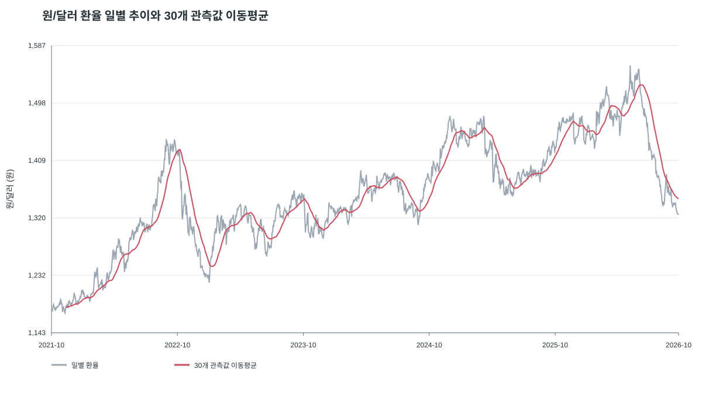
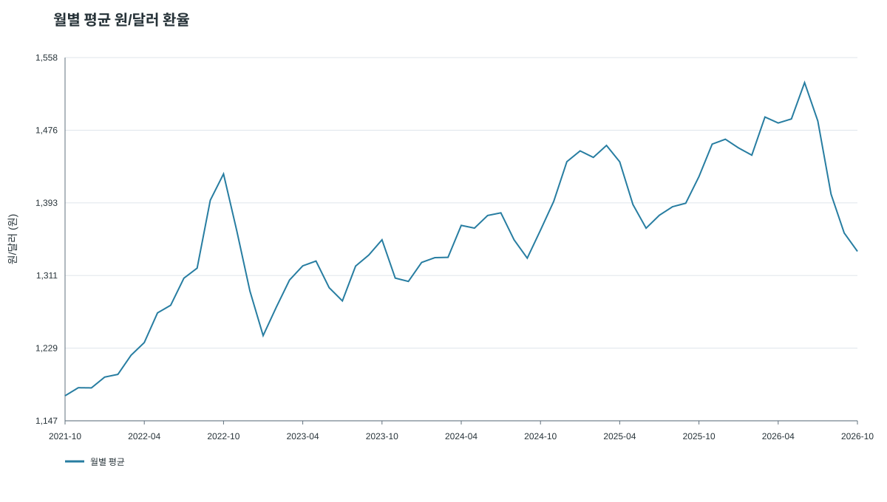
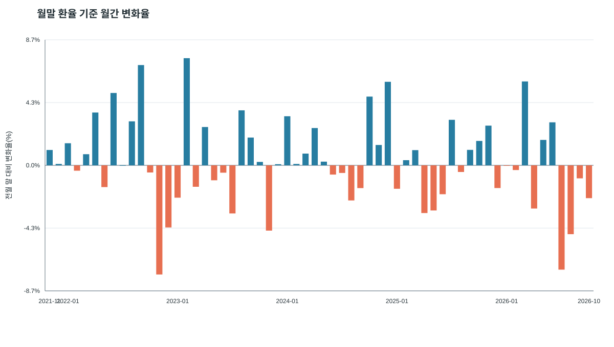

# 원/달러 환율 5년 추이 분석 리포트

## 1. 분석 주제와 목적

미국 달러 1달러를 사는 데 필요한 원화 금액이 최근 5년 동안 어떻게 변했는지 살펴본다. 일별 흐름과 이동평균, 월별 평균 및 월말 기준 월간 변화를 함께 비교해 장기 추세와 변동 구간을 확인한다.

## 2. 분석 질문

1. 5년 동안 원/달러 환율은 전반적으로 어떻게 변했나?
2. 환율이 크게 오르거나 내린 시기는 언제인가?
3. 이동평균과 월별 평균에서 어떤 흐름이 보이나?

## 3. 데이터 설명 및 정제

- **출처:** FRED, 미국 연방준비제도 이사회 제공 시계열 `DEXKOUS`.
- **자료 설명:** South Korean Won to U.S. Dollar Spot Exchange Rate. 단위는 미국 달러 1달러당 원화(KRW per USD), 일별 빈도이며 뉴욕 기준 정오 매입 환율이다. 한국은행 고시 환율과 산출 기준이 같다고 가정하지 않는다.
- **출처 링크:** [FRED DEXKOUS 데이터 및 메타데이터](https://fred.stlouisfed.org/series/DEXKOUS)
- **분석 대상 기간:** 2021-10-29~2026-10-29.
- **실제 데이터 범위:** 첨부 CSV에서 기간 안에 관측된 값은 2021-10-29~2026-10-23이다. 파일이 분석 종료일보다 앞서 끝나므로 마지막 6일은 포함되지 않는다.
- **표본 크기:** 지정 기간의 유효한 일별 관측값 1,246개. FRED CSV의 기간 내 행 중 55개는 `.`으로 표시된 값 없음이다.
- **결측치 처리:** `.` 및 빈 값은 결측으로 인식해 분석에서 제외한다. 값을 보간하거나 0으로 채우지 않았다. 환율 시계열에서 결측일을 임의로 채우면 실제로 관측되지 않은 환율을 만들어낼 수 있기 때문이다. 주말은 원본 일별 표에 별도 행으로 포함되지 않는다.
- **이상치 처리:** 값 자체를 임의로 제거하지 않았다. 급격한 변화도 실제 시장 변동일 수 있으므로 관측값을 보존하고, 큰 하루 변화는 별도로 표시했다. 단일 지점의 값 오류 여부는 원천 기록과 대조하지 못했다.
- **분석에서의 하루 변화:** 인접한 유효 관측값 간 차이를 뜻한다. 결측 행이 사이에 있을 수 있어 반드시 달력상 하루 변화인 것은 아니다.

## 4. 분석 방법

1. **기초 통계와 구간 비교:** 첫 관측값과 마지막 관측값, 최저·최고값 및 변화율을 계산했다.
2. **30개 관측값 이동평균:** 직전 30개의 유효한 환율 관측값 평균이다. 거래일 약 6주에 해당하며, 일별 흔들림을 줄여 중기 흐름을 본다. 달력 기준 30일 평균은 아니다.
3. **월별 평균:** 각 달에 기록된 유효 관측값의 산술평균이다. 시작·끝 달은 기간이 일부만 포함될 수 있다.
4. **월간 변화율:** 매월 마지막 유효 환율을 직전 달의 마지막 유효 환율과 비교했다. 시작과 끝 달이 불완전할 수 있으므로 참고 지표로 해석한다.

## 5. 시각화 및 관찰

### 일별 환율과 이동평균



일별 값의 잦은 등락과 30개 관측값 이동평균의 중기 흐름을 비교한다. 이동평균은 각 시점 직전 30개 유효 관측값부터 계산한다.

### 월별 평균 환율



월 단위로 집계해 장기 방향을 확인한다. 시작과 끝의 부분 월은 다른 월보다 관측일 수가 적을 수 있다.

### 월말 기준 월간 변화율



매월 마지막 유효값의 전월 말 대비 변화율을 보여준다. 이 그래프는 환율 수준이 아니라 월간 변화의 방향과 크기를 비교한다.

## 6. 인사이트

### 인사이트 1: 전체 기간의 시작과 끝을 비교하면 환율은 상승했다

- **관찰(Fact):** 2021-10-29 첫 관측값은 1,174.94원, 2026-10-23 마지막 관측값은 1,325.06원이다. 두 값을 비교한 상승률은 **12.78%**다.
- **해석(Hypothesis):** 기간 끝에는 시작 시점보다 달러 1달러를 사는 데 더 많은 원화가 필요했다. 이는 해당 두 시점 사이의 비교이며, 5년 내내 상승했다는 뜻은 아니다.
- **후속 확인:** 환율 변화 원인을 설명하려면 금리, 달러지수, 무역·정책 뉴스 등 별도 자료와 날짜를 맞춰 비교해야 한다.

### 인사이트 2: 2026년 중반에 기간 최고점을 기록한 뒤 하락했다

- **관찰(Fact):** 지정 기간의 최저값은 2021-12-09의 **1,173.59원**, 최고값은 2026-06-05의 **1,555.96원**이다. 마지막 관측값 1,325.06원은 최고값보다 **14.84% 낮다**.
- **해석(Hypothesis):** 전체 기간의 종점 비교는 상승이지만, 최근 구간만 보면 최고점 이후 뚜렷한 하락이 관찰된다. 따라서 전체 추세 하나만으로 기간별 변화를 요약하면 중간의 전환을 놓칠 수 있다.
- **후속 확인:** 최고점 전후 구간을 확대해 월말 변화율과 관련 거시 지표를 함께 확인한다.

### 인사이트 3: 이동평균과 월별 평균도 중반 상승 후 하락을 보여준다

- **관찰(Fact):** 30개 관측값 이동평균은 2026-07-07에 약 **1,525.83원**으로 기간 내 최고였고, 2026-10-23에는 약 **1,349.90원**이다. 2026년 월별 평균은 1월 약 1,455.50원에서 6월 약 **1,529.46원**까지 올랐다가 10월 약 **1,338.38원**으로 내려왔다.
- **해석(Hypothesis):** 일별 노이즈를 줄인 두 집계에서도 2026년 중반 이후 하락 방향이 확인된다. 이동평균과 월별 평균의 봉우리가 정확히 같은 날짜가 아닌 것은 집계 기간과 계산 방식이 다르기 때문이다.
- **한계:** 2026년 10월은 23일까지 자료만 있는 부분 월이다.

### 인사이트 4: 하루 단위 변화가 큰 날짜가 있어 일별 변동도 확인할 필요가 있다

- **관찰(Fact):** 인접 유효 관측값 기준 가장 큰 상승은 2026-03-03에 **45.80원(+3.18%)**, 가장 큰 하락은 2022-11-14에 **50.14원(-3.64%)**이었다.
- **해석(Hypothesis):** 장기 평균만으로는 이런 단기 급변을 파악하기 어렵다. 급변 날짜는 사건 조사 후보이지, 그 날짜의 변화가 특정 사건 때문에 발생했다는 증거는 아니다.
- **후속 확인:** 원천 데이터와 당시 뉴스·정책 발표를 확인하고, 결측일을 사이에 둔 변화인지도 점검한다.

## 7. 결론과 한계

첨부 CSV의 약 5년 자료에서는 시작값과 마지막값 비교 기준으로 원/달러 환율이 12.78% 상승했다. 그러나 2026년 6월 고점 이후에는 크게 하락했으며, 이동평균과 월별 평균에서도 그 방향이 확인된다. 큰 일별 변화가 발생한 날짜는 추가 원인 조사가 필요한 후보로 볼 수 있다.

이 분석은 환율 하나만 사용한 기술적 요약이라 변동 원인을 인과적으로 설명하지 못한다. 사용한 시계열은 뉴욕 기준 정오 환율이며, 실제 환전소·은행 거래 가격과 차이가 날 수 있다. 데이터 파일은 종료일인 2026-10-29보다 앞선 2026-10-23까지만 관측값을 제공하고, 일별 자료의 일부 날짜는 결측이다. 이동평균은 30개 관측값을 사용해 달력상의 30일과 다르다. 시작·끝 달의 월별 통계와 월간 수익률도 불완전한 달의 영향을 받는다.

## 8. 재현 방법

프로젝트 폴더에서 Python 3.10 이상으로 실행한다.

```bash
python analyze.py
```

실행하면 `images/` 아래 SVG 그래프 3개를 다시 생성하고, 표본 수와 주요 통계를 터미널에 출력한다. 외부 Python 패키지는 필요하지 않다. 원본 CSV는 `data/DEXKOUS.csv`에 포함했다.

## 9. AI 사용 로그

- **사용 작업:** 분석 질문 구체화, Python 분석·시각화 코드 작성, 요약 수치 계산, 그래프 설명과 리포트 초안 작성에 AI를 사용했다.
- **사용 이유:** 반복 계산을 자동화하고, 분석 결과를 과제 형식에 맞춰 정리하기 위해 사용했다.
- **검증 방법:** 작성한 스크립트를 동봉 CSV에 실행해 관측 수, 날짜 범위, 첫·마지막 값, 최저·최고값, 주요 변화율과 이동평균을 다시 계산했다. 앞선 수동 요약과 스크립트 결과를 대조하고, 그래프 축·집계 정의를 코드와 리포트 사이에서 확인했다. 경제적 원인은 환율 자료만으로 확정하지 않았다.

## 10. 출처 및 사용 주의

원자료는 Board of Governors of the Federal Reserve System의 H.10 Foreign Exchange Rates를 FRED에서 내려받은 것이다. FRED는 이 시리즈를 `DEXKOUS`로 제공하고 출처 인용을 요청한다. 원자료의 재배포·사용 시에는 [시리즈 페이지의 저작권 및 인용 안내](https://fred.stlouisfed.org/series/DEXKOUS)를 확인한다. 이 프로젝트는 교육 목적 분석이며 투자 판단을 위한 자료가 아니다.
